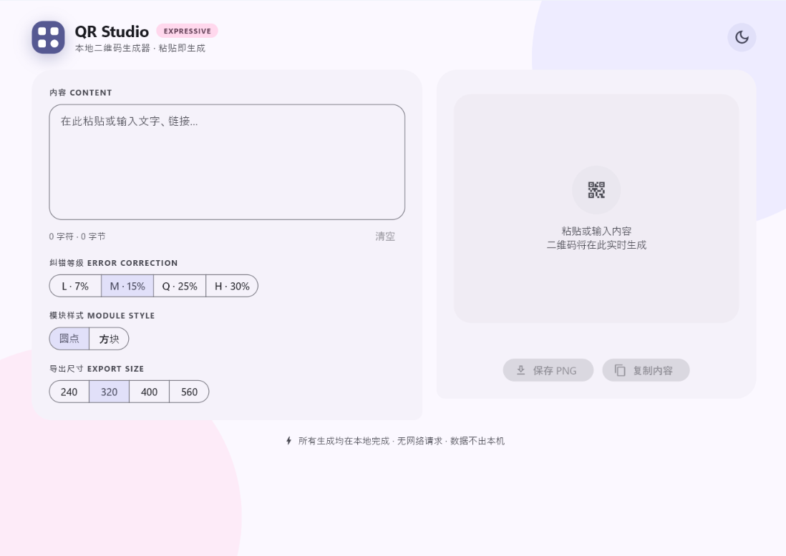

<div align="center">

# QR Studio

**本地二维码生成器 · Material 3 Expressive · Windows 桌面**

粘贴即生成。全程离线，无网络请求，数据不出本机。



</div>

## 功能

| | |
|:---|:---|
| **即时生成** | 粘贴或输入内容实时出码，支持中文、emoji、URL |
| **纠错等级** | L / M / Q / H 四档 |
| **模块样式** | 圆点（定位角为圆角环 + 圆角内心，保持可扫描性）或方块 |
| **导出尺寸** | 240 / 320 / 400 / 560 |
| **保存 PNG** | 原生「另存为」对话框，按 3 倍像素密度导出 |
| **主题** | 深浅色，跟随系统并可手动切换 |
| **实时信息** | QR 版本 / 模块数 / UTF-8 字节数；超长内容给出容量上限提示 |

## 获取可执行文件

构建由 GitHub Actions 完成（`windows-latest` runner 自带 VS 2022 + Windows SDK）。

**Actions → Build Windows Release → 最新跑批 → 页面底部 Artifacts → 下载 `QRStudio-Windows`**

解压后的目录：

```
QRStudio.exe                       ← 双击运行
flutter_windows.dll                ← 运行时
file_selector_windows_plugin.dll   ← 原生「另存为」
app.ico
data/                              ← 应用资源
```

> Flutter 桌面产物不是单文件，**整个目录一起拷贝**才能在其他机器上运行。要求 Windows 10/11 x64。

## 构建

**推荐走 CI。** 推送到 `main`（或打 `v*` tag、手动 `workflow_dispatch`）即触发云端构建：

```bash
git push origin main
```

仓库不提交 `windows/` 平台目录——CI 会用 `flutter create` 在临时目录生成脚手架再拷过来，因此 `lib/main.dart` 不会被模板覆盖。窗口标题、初始尺寸、应用图标也由 CI 在此步骤自动改写。

**本地构建**需要 Flutter SDK ≥ 3.5 + Visual Studio 2022（勾选「使用 C++ 的桌面开发」工作负载）：

```bash
flutter create --platforms=windows --project-name qr_studio --org dev.qrstudio _scaffold
cp -r _scaffold/windows . && rm -rf _scaffold
flutter pub get
flutter build windows --release
```

产物在 `build/windows/x64/runner/Release/`。

## 项目结构

```
qr_flutter/
├── lib/main.dart                         # 全部应用代码（界面 + 二维码绘制）
├── pubspec.yaml                          # qr ^3.0.2 · file_selector ^1.0.3
├── assets/
│   ├── app_icon.ico
│   └── screenshot.png
└── .github/workflows/build-windows.yml   # 云端构建流水线
```

## 实现说明

- Flutter stable（构建于 3.47.7）+ Material 3，色板由 `ColorScheme.fromSeed` 派生
- 二维码编码用 [`qr`](https://pub.dev/packages/qr)：`QrImage(QrCode.fromData(data: ..., errorCorrectLevel: ...))`，UTF-8 原生支持，`QrErrorCorrectLevel` 是 int 常量容器
- 模块渲染为自绘 `CustomPainter`；深色模式下自动反色保证对比度
- 保存走 `file_selector` 原生对话框；无任何网络权限与遥测

## License

[MIT](LICENSE)
